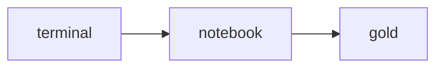
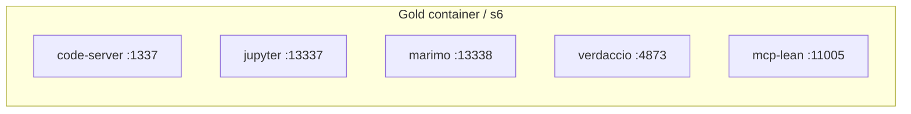

# Project Architecture
> 🚧 UNDER CONSTRUCTION

## Image Design
> [!NOTE]
> Image build and publishing targets are defined in the [Makefile](./Makefile). The configured public registry is `ghcr.io/jhwohlgemuth`.

The following images are available:
- `ghcr.io/jhwohlgemuth/terminal`: Core image with all necessary system dependencies (intended for terminal-only development)
- `ghcr.io/jhwohlgemuth/notebook`: Images with [Jupyter notebook](https://github.com/jupyter/notebook) server, [code-server](https://github.com/coder/code-server) and [Verdaccio](https://verdaccio.org/) proxy npm registry [1](#1) services managed by [s6-overlay](https://github.com/just-containers/s6-overlay)
- `ghcr.io/jhwohlgemuth/gold`: The primary purpose of this repository.
    - All the features of `notebook`
    - Rust and WebAssembly (WASM) development environment
    - Proof assistants
    - Provers
    - Other tools for software correctness

The images are built according to the following dependency graph:

### Build Targets

| Image | Linux amd64 | Linux arm64 | Prerequisite built by the target |
| --- | --- | --- | --- |
| Terminal | `make terminal-image-amd64` | `make terminal-image-arm64` | None |
| Notebook | `make notebook-image-amd64` | `make notebook-image-arm64` | Terminal for the same platform |
| Gold | `make gold-image-amd64` | No target | Notebook and Terminal for amd64 |

These targets build and tag local images with the configured version and `latest`; they do not push them. Both architectures use the same local tag names, so validate each platform before building the other under those tags. The targets establish build paths, not passing build or runtime evidence.

`make terminal-image` and `make notebook-image` use Buildx to build **and push** both architectures.
Publish Terminal before Notebook because Notebook consumes the matching Terminal image from the registry.
There is no `make gold-image` target; Gold uses `make gold-image-amd64`, followed by `make push-gold` when publishing is intended.
Registry access and a builder supporting the requested platforms are required for publishing.

## Lean MCP Service

`config/mcp-lean/service` defines the s6 service `mcp-lean` (lean-lsp-mcp 0.30.0 via `uv 0.8.22`, `Dockerfile:16,34`). It runs alongside `code-server`, `jupyter`, `marimo` and `verdaccio` under s6-overlay (`/etc/services.d/mcp-lean`), listening on `MCP_LEAN_PORT=11005` (streamable-http, `LEAN_PROJECT_PATH`, `LEAN_LOG_LEVEL`). The image already ships `nixpkgs.elan`, so no sidecar or `lean-cache`/`elan` volumes are needed.

## Related Environments

Its initial release consumes a pinned Notebook image as a documented base-image dependency while keeping its versioning, runtime services, and release lifecycle independent from Gold.
Formal verification (Lean LSP MCP, formerly Goldsmith's `mcp-lean --profile formal` sidecar) now lives in Gold as an s6 service alongside code-server/Jupyter.

## Service Topology

-------------

## Footnotes

### [1]
> Default Verdaccio proxy npm registry port is `4873` ([documentation](https://verdaccio.org/docs/configuration#listen-port))
